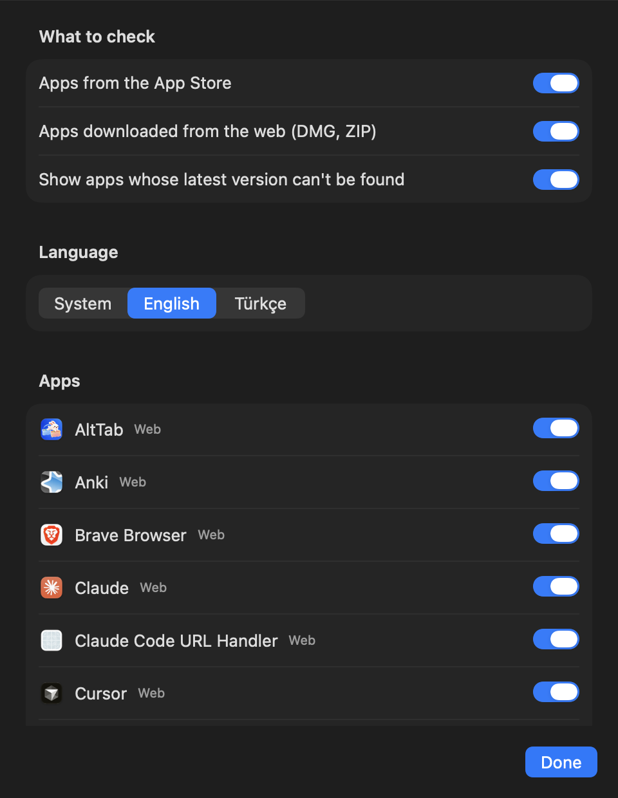

<p align="center">
  
</p>

<h1 align="center">Check Updates</h1>

<p align="center">
  Checks every app on your computer for updates and updates them with one click. Free, for Mac and Windows.<br>
  Bilgisayarındaki her uygulamanın güncellemesini kontrol eder ve tek tıkla günceller. Ücretsiz, Mac ve Windows için.
</p>

<p align="center">
  <a href="https://check-updates.armanalis.workers.dev"><b>Website</b></a> ·
  <a href="#install--kurulum">Install</a> ·
  <a href="#how-it-works">How it works</a>
</p>

<table>
  <tr>
    <td width="62%"></td>
    <td width="38%"></td>
  </tr>
  <tr>
    <td align="center">One list, one click: <b>Update All</b></td>
    <td align="center">Pick what to check · English / Türkçe</td>
  </tr>
</table>

## Install / Kurulum

**Mac** (Terminal):

```bash
curl -fsSL https://check-updates.armanalis.workers.dev/install.sh | sh
```

**Windows** (PowerShell):

```powershell
irm https://check-updates.armanalis.workers.dev/install.ps1 | iex
```

## How it works

| | Mac | Windows |
|---|---|---|
| Finds latest versions | App Store, [Homebrew](https://brew.sh) cask catalog, Sparkle feeds | `winget upgrade` |
| Updates | `brew install --cask --force`, App Store, or the app's own updater | `winget upgrade --id` |
| Code | [`main.swift`](main.swift) (SwiftUI) | [`windows/`](windows) (C#, WinForms, .NET Framework 4.8) |

Nothing is sent anywhere except version lookups to Apple, Homebrew and the apps' own update feeds.

## Build

```bash
./build.sh            # Mac app → build.noindex/, website/public/CheckUpdates.zip
windows/build.sh      # Windows exe → website/public/CheckUpdates.exe (needs .NET SDK)
./make_icon.sh        # regenerate AppIcon.icns
```

Deploy the website (Cloudflare Workers): `cd website && npx wrangler deploy`

---

Made by [armanalis](https://github.com/armanalis)
