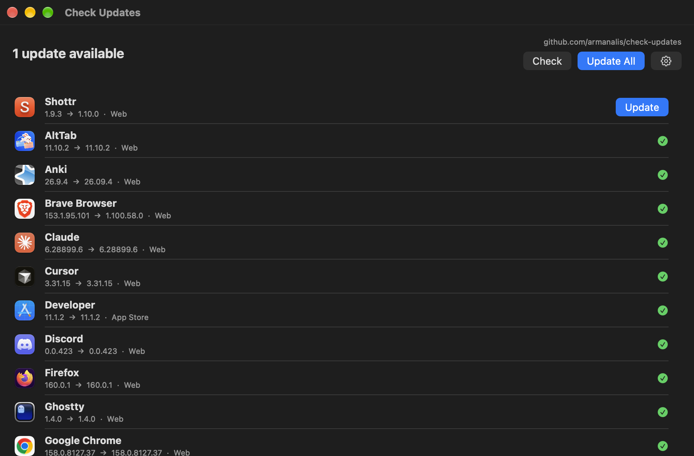

<p align="center">
  
</p>

<h1 align="center">Check Updates</h1>

<p align="center">
  Checks every app on your computer for updates and updates them with one click. Free, for Mac and Windows.<br>
  Bilgisayarındaki her uygulamanın güncellemesini kontrol eder ve tek tıkla günceller. Ücretsiz, Mac ve Windows için.
</p>

<p align="center">
  <a href="https://check-updates.armanalis.workers.dev"><b>Website</b></a> ·
  <a href="#install--kurulum">Install</a> ·
  <a href="#features">Features</a> ·
  <a href="#how-it-works">How it works</a>
</p>

<p align="center"><sub>Mac screenshots. The Windows app has the same features in a native Windows window.</sub></p>

<table>
  <tr>
    <td width="62%"></td>
    <td width="38%"></td>
  </tr>
  <tr>
    <td align="center">One list, one click: <b>Update All</b></td>
    <td align="center">Pick what to check · English / Türkçe</td>
  </tr>
</table>

## Install / Kurulum

**Mac** (macOS 13+, Apple Silicon and Intel) — open Terminal and run ([step by step on the website](https://check-updates.armanalis.workers.dev/#mac)):

```bash
curl -fsSL https://check-updates.armanalis.workers.dev/install.sh | sh
```

**Windows** (Windows 10 and 11) — open PowerShell (no admin needed) and run ([step by step on the website](https://check-updates.armanalis.workers.dev/#windows)):

```powershell
irm https://check-updates.armanalis.workers.dev/install.ps1 | iex
```

Both commands just download the app and open it; read them first if you like: [`install.sh`](website/public/install.sh), [`install.ps1`](website/public/install.ps1).
Prefer a plain download? Get [`CheckUpdates.zip`](https://check-updates.armanalis.workers.dev/CheckUpdates.zip) (Mac) or [`CheckUpdates.exe`](https://check-updates.armanalis.workers.dev/CheckUpdates.exe) (Windows). The apps aren't signed yet, so macOS / Windows SmartScreen will warn once.

## Features

| | Mac | Windows |
|---|:---:|:---:|
| Checks every installed app on launch or with **Check** | ✓ | ✓ |
| **Update All**, or one app at a time | ✓ | ✓ (double-click or right-click) |
| Live download percentage and spinner | ✓ | ✓ |
| Clear reason when an update fails, with a fix button | ✓ | ✓ |
| Apps that need your password / admin rights | Asks for the Mac password right away | Right-click → **Retry as Administrator** (UAC) |
| Hide apps you don't want checked | Right-click → **Hide from List** | Right-click → **Hide from List** |
| Settings: what to check, hidden apps, language | App Store / web apps, per-app switches | Microsoft Store / other apps, hidden apps |
| English and Turkish | ✓ | ✓ |

## How it works

| | Mac | Windows |
|---|---|---|
| Finds latest versions | App Store, [Homebrew](https://brew.sh) cask catalog, and the app's own update feed (Sparkle feed from Info.plist or found inside the app, electron-builder `app-update.yml`). The newest answer wins. App Store apps are compared by their short version only, since the build number (Office: `16.115.26110837`) is not what the store reports. | [winget](https://learn.microsoft.com/windows/package-manager/winget/), Windows' built-in package manager (`winget upgrade --include-unknown`): the winget catalog and the Microsoft Store, including apps whose installed version winget can't read (shown as `Unknown`) |
| Updates | `brew install --cask --force`, App Store, or the app's own updater | `winget upgrade --id <app> --silent`, elevated through UAC when needed |
| Settings stored in | macOS user defaults (`com.armanalis.checkupdates`) | `%APPDATA%\CheckUpdates\settings.txt` |
| Installed to | `/Applications` (or `~/Applications`) | `%LOCALAPPDATA%\Programs\CheckUpdates`, with a Start menu shortcut |
| Code | [`main.swift`](main.swift) (SwiftUI) | [`windows/`](windows) (C#, WinForms, .NET Framework 4.8) |

Nothing is sent anywhere except version lookups: on Mac to Apple, Homebrew and the apps' own update feeds; on Windows through winget to Microsoft's catalogs.

Mac: check which source answered for every app, and where they disagree:

```bash
"/Applications/Check Updates.app/Contents/MacOS/CheckUpdates" --audit
```

## Build

```bash
./build.sh            # Mac app → build.noindex/, website/public/CheckUpdates.zip
windows/build.sh      # Windows exe → website/public/CheckUpdates.exe; runs the tests first (needs .NET SDK, works on Mac)
./make_icon.sh        # regenerate AppIcon.icns
```

The Windows app targets .NET Framework 4.8, which ships with Windows 10 and 11, so the 60 KB `.exe` runs without installing anything.
Testing it on a real PC: [`windows/TEST-CHECKLIST.md`](windows/TEST-CHECKLIST.md).

Deploy the website (Cloudflare Workers): `cd website && npx wrangler deploy`

## License

[MIT](LICENSE) © 2026 Ali Arman Dai. Free to use, change and share.

---

Made by [armanalis](https://github.com/armanalis)
